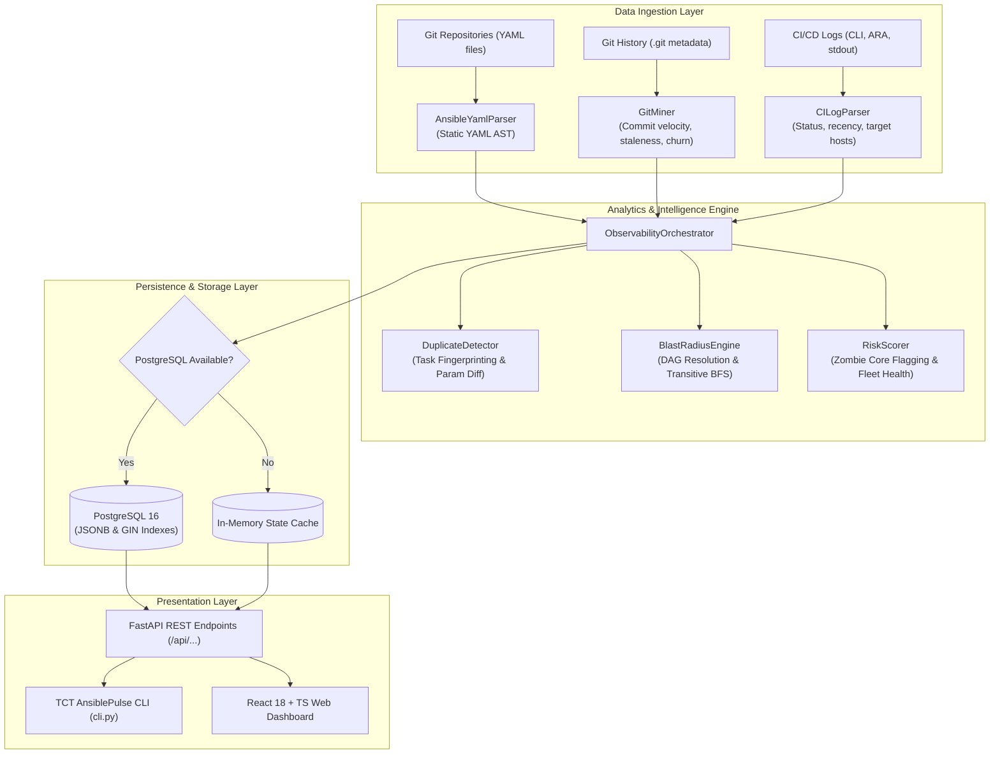

# TCT AnsiblePulse — Comprehensive Project Documentation & Technical Specification

> **Read-Only Observability & Blast Radius Intelligence Layer for Fragmented Ansible & IaC Scripts**

[](#)
[](#)
[](#)
[](#)
[](#)

---

## Table of Contents
1. [Executive Summary](#1-executive-summary)
2. [The Core Problem It Solves](#2-the-core-problem-it-solves)
3. [Design Philosophy & Non-Invasive Architecture](#3-design-philosophy--non-invasive-architecture)
4. [System Architecture & Data Flow](#4-system-architecture--data-flow)
5. [Core Engines & Technical Mechanics](#5-core-engines--technical-mechanics)
   - [5.1 Safe YAML AST Parser](#51-safe-yaml-ast-parser)
   - [5.2 Git History & Churn Miner](#52-git-history--churn-miner)
   - [5.3 CI/CD Execution Log Parser](#53-cicd-execution-log-parser)
   - [5.4 Duplicate & Divergence Detection Engine](#54-duplicate--divergence-detection-engine)
   - [5.5 Blast Radius & Dependency DAG Engine](#55-blast-radius--dependency-dag-engine)
   - [5.6 Multi-Factor Risk Intelligence Scorer](#56-multi-factor-risk-intelligence-scorer)
   - [5.7 Security, Compliance & Anti-Pattern Linter](#57-security-compliance--anti-pattern-linter)
   - [5.8 Canonical Remediation & Git Patch Synthesizer](#58-canonical-remediation--git-patch-synthesizer)
   - [5.9 Executive Governance Report Generator](#59-executive-governance-report-generator)
6. [Data Storage & Persistence Layer](#6-data-storage--persistence-layer)
7. [User Interfaces & Product Capabilities](#7-user-interfaces--product-capabilities)
   - [7.1 Executive Overview Dashboard](#71-executive-overview-dashboard)
   - [7.2 Duplicate-Functionality Matrix](#72-duplicate-functionality-matrix)
   - [7.3 Blast Radius Topology & Interactive DAG](#73-blast-radius-topology--interactive-dag)
   - [7.4 High-Risk Governance Radar](#74-high-risk-governance-radar)
   - [7.5 Unified Script Catalog & AST Inspector](#75-unified-script-catalog--ast-inspector)
   - [7.6 Live Impact Simulator](#76-live-impact-simulator)
   - [7.7 Enterprise ROI & Business Value Calculator](#77-enterprise-roi--business-value-calculator)
8. [CLI Tool & CI/CD Pipeline Integration](#8-cli-tool--cicd-pipeline-integration)
9. [REST API Specification](#9-rest-api-specification)
10. [Why TCT AnsiblePulse is Useful (Business Impact & ROI)](#10-why-tct-ansiblepulse-is-useful-business-impact--roi)
11. [Installation, Verification & Quickstart Guide](#11-installation-verification--quickstart-guide)

---

## 1. Executive Summary

**TCT AnsiblePulse** is an enterprise-grade observability and governance intelligence platform engineered specifically for organizations struggling with **fragmented, multi-repository Ansible playbooks, roles, and Infrastructure-as-Code (IaC) configurations**.

As platform and DevOps engineering teams scale beyond 5+ engineers, Ansible scripts inevitably disperse across dozens of individual repositories, repositories become out of sync, and engineers duplicate identical operational tasks with minute, uncoordinated variations.

TCT AnsiblePulse acts as a **unified telemetry and static analysis lens** across your entire infrastructure estate:
- It **indexes** all plays, tasks, roles, and variables across isolated git repositories.
- It **identifies duplicate code and configuration drift** down to the individual parameter level.
- It **maps dependency blast radius** across repos using a directed acyclic graph (DAG).
- It **flags critical governance risks**, specifically unmaintained "Zombie Core Assets" anchoring production clusters.
- It provides **live pre-commit impact simulations** to prevent broken production deployments.

---

## 2. The Core Problem It Solves

In medium-to-large engineering organizations, the primary operational challenge is **not writing Ansible code**, but managing **cross-team code sprawl and invisible dependencies**:

```
                       The Fragmented IaC Dilemma
   Repo: platform-core-infra       Repo: ecommerce-frontend      Repo: payments-gateway
  ┌────────────────────────┐      ┌────────────────────────┐    ┌────────────────────────┐
  │ roles/common_base      │◄─────┤ includes 'common_base' │    │ Duplicate task:        │
  │ (Stale: 420+ days)     │      │ Docker: v24.0.5        │    │ Docker: v20.10.12      │
  │ Blast Radius: 4 plays  │      └────────────────────────┘    └────────────────────────┘
  └───────────┬────────────┘                                                ▲
              │                                                             │
              └───────────────────────────┬─────────────────────────────────┘
                                          ▼
                         Divergent Parameters, Unknown Impact,
                            Outdated Zombie Base Roles
```

### The 4 Major Pain Points:
1. **Duplicate Drift Across Repositories**:
   Different teams frequently need the same baseline capability (e.g., Docker engine setup, Nginx proxy configuration, user SSH key provisioning, sysctl kernel tuning). Without a shared discovery catalog, engineers copy-paste and rewrite these scripts in 3 to 5 repositories. Over time, package names, security flags, and daemon flags diverge silently.
2. **Invisible Blast Radius**:
   When a platform engineer modifies or updates a foundational role (such as a company-wide base hardening role), there is no native Ansible mechanism to identify which downstream microservice playbooks and production environments will be impacted or broken.
3. **Active vs. Dormant Version Invisibility**:
   In large Git organizations, multiple versions of a playbook or role exist across branches and repositories. Teams often have zero visibility into which script version is actively executing in production versus abandoned copies that have not run in months.
4. **Zombie Core Dependencies**:
   Foundational infrastructure roles that anchor dozens of downstream playbooks often sit untouched for 6 to 18 months because the original author left the team or everyone is afraid to touch them. When changes are finally forced (e.g., OS upgrades), unexpected catastrophic outages occur.

---

## 3. Design Philosophy & Non-Invasive Architecture

TCT AnsiblePulse adheres strictly to a **Read-Only Observability Philosophy**:

| Principle | How TCT AnsiblePulse Implements It |
| :--- | :--- |
| **Zero Execution Risk** | TCT AnsiblePulse **never executes or mutates** any playbook, host, or cloud infrastructure. It treats Ansible YAML purely as code artifacts. |
| **Static AST Parsing** | Parses YAML Abstract Syntax Trees (AST) with custom safe loaders that do not evaluate dynamic Jinja templates or decrypt secrets. |
| **Passive Telemetry Ingestion** | Ingests existing Git metadata (`git log`, commit churn) and CI/CD execution recaps (`ansible-playbook` stdout, ARA records) without requiring agents on target nodes. |
| **Frictionless Fallback** | Runs with a high-performance PostgreSQL 16 database backend, but seamlessly falls back to an in-memory cache if no database is configured. |

---

## 4. System Architecture & Data Flow

The following sequence and architecture diagram illustrates the end-to-end pipeline:



---

## 5. Core Engines & Technical Mechanics

### 5.1 Safe YAML AST Parser
Located in [`backend/app/scanner/yaml_parser.py`](file:///d:/Program/IT%20Operations%20&%20Endpoint%20Management/Observability%20Layer%20for%20Fragmented%20Ansible%20%20IaC%20Scripts/backend/app/scanner/yaml_parser.py).

The AST parser converts raw Ansible YAML files into structured [`AnsibleAsset`](file:///d:/Program/IT%20Operations%20&%20Endpoint%20Management/Observability%20Layer%20for%20Fragmented%20Ansible%20%20IaC%20Scripts/backend/app/models/schemas.py#L59) and [`AnsibleTask`](file:///d:/Program/IT%20Operations%20&%20Endpoint%20Management/Observability%20Layer%20for%20Fragmented%20Ansible%20%20IaC%20Scripts/backend/app/models/schemas.py#L26) objects:
- **`SafeAnsibleYamlLoader`**: Subclasses `yaml.SafeLoader` with a multi-constructor that safely intercepts custom tags like `!vault`, `!unsafe`, and unquoted Jinja tokens without throwing parse exceptions or decrypting sensitive credentials.
- **FQCN Normalization**: Standardizes Fully Qualified Collection Names (e.g. `ansible.builtin.apt` $\rightarrow$ `apt`, `community.docker.docker_container` $\rightarrow$ `docker_container`) so that modules written in legacy short syntax and modern collection syntax are compared accurately.
- **Structural Task Identification**: Distinguishes Ansible control directives (`become`, `when`, `tags`, `notify`, `loop`, `register`) from the actual module invocation payload.
- **Fingerprint Computation**: Computes a canonical signature $S = \text{module}::\text{normalized\_target}$ by stripping variable markers (`{{ var }}` $\rightarrow$ `__VAR__`), enabling fuzzy semantic comparisons across repos.

### 5.2 Git History & Churn Miner
Located in [`backend/app/scanner/git_miner.py`](file:///d:/Program/IT%20Operations%20&%20Endpoint%20Management/Observability%20Layer%20for%20Fragmented%20Ansible%20%20IaC%20Scripts/backend/app/scanner/git_miner.py).

The Git miner measures the human lifecycle and maintenance health of each infrastructure script:
- **Days Since Last Commit**: Direct metric of asset abandonment.
- **Commit Velocity (90 Days)**: Measures active development vs. stable legacy states.
- **Author Count & Multi-Author Churn**: Identifies scripts being edited by multiple disjoint authors without consensus, a leading indicator of configuration drift.
- **Staleness Score Calculation**:
  $$\text{Staleness Score} = \begin{cases} 0.0 & \text{if } \text{days} \le 14 \\ 1.0 & \text{if } \text{days} \ge 180 \\ \frac{\text{days}}{180.0} & \text{otherwise} \end{cases}$$

### 5.3 CI/CD Execution Log Parser
Located in [`backend/app/scanner/ci_log_parser.py`](file:///d:/Program/IT%20Operations%20&%20Endpoint%20Management/Observability%20Layer%20for%20Fragmented%20Ansible%20%20IaC%20Scripts/backend/app/scanner/ci_log_parser.py).

Bridges the gap between code on disk and runtime reality:
- **Regex Extraction of CLI Recaps**: Analyzes standard Ansible terminal outputs:
  ```text
  PLAY RECAP *********************************************************************
  web-node-01 : ok=12 changed=3 unreachable=0 failed=0
  ```
- **Execution State Categorization**: Maps runs to [`ExecutionStatus`](file:///d:/Program/IT%20Operations%20&%20Endpoint%20Management/Observability%20Layer%20for%20Fragmented%20Ansible%20%20IaC%20Scripts/backend/app/models/schemas.py#L13) (`SUCCESS`, `CHANGED`, `FAILED`, `UNREACHABLE`, or `NEVER_RUN`).
- **Production Verification**: Flags whether a playbook has verified execution logs against production inventory hosts or only staging/sandbox targets.
- **30-Day Failure Rate**: Tracks reliability trends across deployments.

### 5.4 Duplicate & Divergence Detection Engine
Located in [`backend/app/analytics/duplicate_detector.py`](file:///d:/Program/IT%20Operations%20&%20Endpoint%20Management/Observability%20Layer%20for%20Fragmented%20Ansible%20%20IaC%20Scripts/backend/app/analytics/duplicate_detector.py).

Computes granular pairwise and clustered similarity across multi-repo playbooks:
- **Module Group Equivalence**: Groups synonymous modules (e.g., `apt`, `yum`, `dnf`, `package`; `copy`, `template`; `service`, `systemd`).
- **Granular Parameter Diffing**: Evaluates the shared keys, differing values, and missing keys between any two task parameter dictionaries:
  - If identical: Flagged as `exact duplicate`.
  - If keys match but values differ (e.g., `state: present` vs `state: latest` or different versions): Flagged as `differing_value`.
  - If present in one file but absent in another: Flagged as `only_in_a` or `only_in_b`.
- **Semantic Clustering**: Aggregates pairwise matches into high-level operational functional groups:
  - *Docker Runtime & Daemon Setup*
  - *Nginx Web Server & Proxy Config*
  - *User Provisioning & SSH Hardening*
  - *Kernel & System Limits Configuration*
- **Role-Level Jaccard Overlap**:
  $$J(Role_A, Role_B) = \frac{|Tasks_A \cap Tasks_B|}{|Tasks_A \cup Tasks_B|}$$
  Identifies entire roles that have been copy-pasted and forked across repositories without upstream sync.
- **Canonical Recommendation Engine**: Automatically selects the best candidate for team consolidation based on declarative module quality and configuration completeness.

### 5.5 Blast Radius & Dependency DAG Engine
Located in [`backend/app/analytics/blast_radius.py`](file:///d:/Program/IT%20Operations%20&%20Endpoint%20Management/Observability%20Layer%20for%20Fragmented%20Ansible%20%20IaC%20Scripts/backend/app/analytics/blast_radius.py).

Builds a Directed Acyclic Graph (DAG) representing the operational dependency structure of your infrastructure:
- **Node Resolution**: Maps every playbook, role, and task file across all scanned repos as nodes.
- **Edge Extraction**: Traces explicit references:
  - `roles:` entries in playbooks
  - `include_role` and `import_role` dynamic tasks
  - `include_tasks` and `import_tasks` invocations
  - `import_playbook` statements
- **Transitive Upstream & Downstream Blast Calculation**:
  Uses a Breadth-First Search (BFS) over the reverse adjacency list to calculate the complete downstream transitive impact score:
  $$\text{Blast Radius}(Node) = |\{ v \in V \mid v \rightsquigarrow Node \}|$$
  *"If role `common_base` is modified or deprecated, exactly which 4 playbooks and microservice clusters are directly or indirectly exposed?"*

### 5.6 Multi-Factor Risk Intelligence Scorer
Located in [`backend/app/analytics/risk_scorer.py`](file:///d:/Program/IT%20Operations%20&%20Endpoint%20Management/Observability%20Layer%20for%20Fragmented%20Ansible%20%20IaC%20Scripts/backend/app/analytics/risk_scorer.py).

Calculates a comprehensive 0–100 risk score based on 5 risk dimensions:

| Risk Dimension | Max Points | Evaluation Criteria |
| :--- | :---: | :--- |
| **Blast Radius Impact** | 40 pts | $\ge 5$ downstream dependents = 40 pts; $\ge 3$ = 30 pts; $\ge 1$ = 15 pts |
| **Staleness & Abandonment** | 35 pts | $\ge 365$ days unmaintained = 35 pts; $\ge 180$ days = 25 pts; $\ge 90$ days = 10 pts |
| **Execution Health** | 15 pts | Recent `FAILED` or `UNREACHABLE` run = 15 pts; `NEVER_RUN` with blast $>0$ = 10 pts |
| **Duplicate Sprawl** | 10 pts | Asset belongs to a divergent duplicate functional cluster |
| **Author Churn Volatility** | 10 pts | $\ge 4$ unique authors with $\ge 5$ commits in the last 90 days |

#### Critical Governance Flag: "Zombie Core Asset"
An asset receives the **`ZOMBIE_CORE_ASSET`** flag whenever:
$$\text{Blast Radius} \ge 2 \quad \text{AND} \quad \text{Days Unmaintained} \ge 180$$
This specifically protects organizations from unmaintained base roles that anchor critical downstream production automation.

#### Fleet Health Score
The platform-wide governance health score (0–100) is computed as:
$$\text{Fleet Health} = \max\left(15.0, 100.0 - \left(12.0 \times N_{\text{zombies}} + 5.0 \times N_{\text{high\_risk}} + 4.0 \times N_{\text{diverged}}\right)\right)$$

### 5.7 Security, Compliance & Anti-Pattern Linter
Located in [`backend/app/analytics/security_linter.py`](file:///d:/Program/IT%20Operations%20&%20Endpoint%20Management/Observability%20Layer%20for%20Fragmented%20Ansible%20%20IaC%20Scripts/backend/app/analytics/security_linter.py).

Performs deep static inspection of task dictionaries and module payloads to detect infrastructure security risks and technical debt:
- **`SEC001_PLAINTEXT_SECRET`**: Identifies hardcoded passwords, tokens, API keys, and sensitive credentials in task parameters without Ansible Vault encryption.
- **`SEC002_INSECURE_PERMS`**: Flags dangerous world-writable file modes (e.g. `mode: '0777'` or `mode: 0666`).
- **`SEC003_INSECURE_DOWNLOAD` / `PIPE_TO_SHELL`**: Flags downloads without SHA256 checksums and dangerous `curl ... | bash` pipelines.
- **`SEC004_NON_IDEMPOTENT_COMMAND`**: Detects raw `command` or `shell` invocations used instead of idempotent native modules (`apt`, `service`, `user`, `git`).
- **`SEC005_DEPRECATED_SYNTAX`**: Flags bare legacy `include:` directives.
- **Compliance Scorecard**: Generates an overall 0–100 compliance score and letter grade (A through F).

### 5.8 Canonical Remediation & Git Patch Synthesizer
Located in [`backend/app/analytics/remediation_engine.py`](file:///d:/Program/IT%20Operations%20&%20Endpoint%20Management/Observability%20Layer%20for%20Fragmented%20Ansible%20%20IaC%20Scripts/backend/app/analytics/remediation_engine.py).

Bridges the gap from static observability to automated resolution:
- Analyzes parameter frequency and value divergences across duplicate variants.
- Extracts differing parameters into clean `defaults/main.yml` variables to preserve environment flexibility.
- Synthesizes a standardized `tasks/main.yml` using Ansible Fully Qualified Collection Names (FQCNs) and best-practice tags.
- Produces a ready-to-apply **Unified Git Diff Patch** (`.patch`) enabling platform teams to consolidate fragmented code with a single `git apply` command.

### 5.9 Executive Governance Report Generator
Located in [`backend/app/analytics/report_generator.py`](file:///d:/Program/IT%20Operations%20&%20Endpoint%20Management/Observability%20Layer%20for%20Fragmented%20Ansible%20%20IaC%20Scripts/backend/app/analytics/report_generator.py).

Produces professional deliverables for CTOs, Lead SREs, and compliance auditors:
- **Markdown (`.md`)**: Ready for inclusion in Git repositories, documentation wikis, and PR summaries.
- **Printable HTML (`.html`)**: Beautifully styled glassmorphic document with clean page breaks, print buttons, and PDF export formatting.
- **Machine-Readable JSON (`.json`)**: Ideal for ingesting into central enterprise data lakes or SIEM platforms.
- Includes fleet health KPIs, Zombie Core registry, duplicate matrix, and a prioritized **30-60-90 day remediation roadmap**.

---

## 6. Data Storage & Persistence Layer

TCT AnsiblePulse features an enterprise data tier designed for rapid querying and longitudinal drift tracking:

### PostgreSQL 16 Architecture
- **Optimized Container**: Defined in [`docker-compose.yml`](file:///d:/Program/IT%20Operations%20&%20Endpoint%20Management/Observability%20Layer%20for%20Fragmented%20Ansible%20%20IaC%20Scripts/docker-compose.yml) and custom configuration [`docker/postgres.conf`](file:///d:/Program/IT%20Operations%20&%20Endpoint%20Management/Observability%20Layer%20for%20Fragmented%20Ansible%20%20IaC%20Scripts/docker/postgres.conf).
- **PostgreSQL Extensions**:
  - `uuid-ossp`: High-performance UUID key generation.
  - `pg_trgm`: Trigram fuzzy search across playbook and role paths.
  - `btree_gin`: Composite GIN indexing on structured JSONB parameter columns.
- **Relational & Schema Design**:
  Defined in [`prisma/schema.prisma`](file:///d:/Program/IT%20Operations%20&%20Endpoint%20Management/Observability%20Layer%20for%20Fragmented%20Ansible%20%20IaC%20Scripts/prisma/schema.prisma) and SQLAlchemy models in [`backend/app/db/models.py`](file:///d:/Program/IT%20Operations%20&%20Endpoint%20Management/Observability%20Layer%20for%20Fragmented%20Ansible%20%20IaC%20Scripts/backend/app/db/models.py):
  - `scan_runs`: Historical audit records tracking fleet health score over time.
  - `assets`: Playbooks, roles, and task files with AST metrics and risk scores.
  - `tasks`: Line-level task definitions, module names, and JSONB parameters.
  - `duplicate_clusters`: Functional cluster variants and canonical recommendations.
  - `blast_edges`: DAG connectivity for dependency graph traversals.
  - `risk_flags`: Prioritized action items and remediation instructions.
- **Dual ORM Support**:
  - **SQLAlchemy 2.0**: With QueuePool connection pooling (`backend/app/db/session.py`).
  - **Prisma Client Python**: High-throughput Rust query engine integration (`backend/app/db/prisma_service.py`).

---

## 7. User Interfaces & Product Capabilities

TCT AnsiblePulse delivers an intuitive, glassmorphic Single Page Application (SPA) built with React 18, TypeScript, and Tailwind CSS.

### 7.1 Executive Overview Dashboard
- **Fleet Health Gauge**: Real-time circular SVG indicator displaying the fleet score (0–100) with color grading (Emerald $\ge 80$, Amber $\ge 60$, Rose $<60$).
- **Critical Governance Flash Banner**: Immediate alert highlighting detected Zombie Core assets, affected playbooks, and required remediation steps.
- **Key Metric Cards**: Instant count of repositories scanned, playbooks, discovered roles, structured tasks, and duplicate clusters.
- **Interactive Quick-Action Triggers**: Direct links to simulate asset blast radius or jump straight to parameter diffs.

### 7.2 Duplicate-Functionality Matrix
- **Semantic Cluster Browser**: Filter clusters by module (`apt`, `docker_container`, `service`, `template`, `user`) or search by name.
- **Side-by-Side Parameter Matrix**: Displays variant implementations across repositories in a synchronized grid.
- **Exact Diff Highlighting**: Identical values are highlighted in subtle gray, while differing values (e.g., mismatched package versions or flags) are prominently highlighted in amber/rose badges.
- **Canonical Recommendation Pill**: Clearly indicates which variant should be adopted as the organizational standard.

### 7.3 Blast Radius Topology & Interactive DAG
- **Multi-Tier Dependency Graph**: Organizes infrastructure into Core Roles, Task Files, and Playbooks.
- **Click-to-Illuminate Downstream Impact**: Clicking any role immediately highlights all downstream dependent playbooks and production microservices while dimming unrelated nodes.
- **Execution Recency Indicators**: Nodes display visual status badges indicating their latest CI execution (`SUCCESS`, `CHANGED`, `FAILED`, `UNREACHABLE`).

### 7.4 High-Risk Governance Radar
- **Quadrant Filtering**: Filter by **Zombie Core**, **Drifted Fork**, or **High Churn**.
- **Actionable Remediation Cards**: For each high-risk asset, provides:
  - Exact risk score and level badge (`CRITICAL`, `HIGH`, `MEDIUM`).
  - Downstream blast count and staleness duration.
  - Plain-English remediation instructions (e.g., *"Audit common_base immediately. Assign an active owner and verify CI test coverage"*).

### 7.5 Unified Script Catalog & AST Inspector
- Searchable and sortable registry of every playbook, role, and task across all connected repositories.
- Line-by-line inspection of task parameters, tags, handlers, and conditionals.

### 7.6 Live Impact Simulator
- Modal window allowing engineers to select any asset and simulate a hypothetical modification, deprecation, or failure.
- Returns the exact list of impacted downstream repositories, targeted production host pools, and overall severity classification before touching a line of code.

### 7.7 Enterprise ROI & Business Value Calculator
- Interactive financial model demonstrating cost savings and ROI based on:
  - Team size (number of engineers).
  - Hours spent on manual script audits per month.
  - Average cost of an infrastructure outage caused by playbook version confusion.
  - Comparison against TCT AnsiblePulse tier pricing ($99/mo Standard vs. $249/mo Enterprise).

---

## 8. CLI Tool & CI/CD Pipeline Integration

The TCT AnsiblePulse CLI ([`cli.py`](file:///d:/Program/IT%20Operations%20&%20Endpoint%20Management/Observability%20Layer%20for%20Fragmented%20Ansible%20%20IaC%20Scripts/cli.py)) allows DevOps engineers to run audits in terminals or enforce governance in CI/CD pipelines (GitHub Actions, GitLab CI, Jenkins):

### Command Reference

```bash
# 1. Scan demo repositories and output human-readable report
python cli.py scan --demo

# 2. Scan custom enterprise repositories with CI execution log directory
python cli.py scan --repos /path/to/repo1 /path/to/repo2 --ci-logs /path/to/ci_logs

# 3. Output scan summary in machine-readable JSON (ideal for CI pipelines)
python cli.py scan --demo --json

# 4. Inspect high-risk governance assets directly in terminal
python cli.py risks --demo

# 5. Simulate the blast radius of a specific role or task file
python cli.py blast-radius --demo --asset "platform-core-infra::roles/common_base/tasks/main.yml"

# 6. Check PostgreSQL 16 connection and pool status
python cli.py db-status

# 7. View historical scan audit runs stored in PostgreSQL
python cli.py db-history --limit 10

# 8. Start the FastAPI API & Web Dashboard server
python cli.py serve --host 127.0.0.1 --port 8000
```

### CI/CD Quality Gate Example (GitHub Actions)
```yaml
name: Ansible Governance Check
on: [pull_request]
jobs:
  iac-audit:
    runs-on: ubuntu-latest
    steps:
      - uses: actions/checkout@v4
      - name: Setup Python
        uses: actions/setup-python@v5
        with:
          python-version: '3.12'
      - name: Run TCT AnsiblePulse Audit
        run: |
          pip install -r requirements.txt
          python cli.py scan --repos . --json > audit_results.json
          python -c "
          import json, sys
          with open('audit_results.json') as f:
              data = json.load(f)
          if data['zombie_core_assets_count'] > 0:
              print(f'❌ Quality Gate Failed: {data[\"zombie_core_assets_count\"]} Zombie Core assets detected!')
              sys.exit(1)
          print('✅ TCT AnsiblePulse Governance Gate Passed!')
          "
```

---

## 9. REST API Specification

The FastAPI backend exposes comprehensive REST endpoints for automation and integration:

| Method | Endpoint | Description |
| :--- | :--- | :--- |
| `GET` | `/api/summary` | Executive summary metrics, overall health score, and risk totals. |
| `GET` | `/api/inventory` | Catalog of all playbooks, roles, and tasks with filter query parameters. |
| `GET` | `/api/inventory/{asset_id}` | Detailed AST structure, git metadata, and simulation for a specific asset. |
| `GET` | `/api/duplicates` | All duplicate functionality clusters across repositories. |
| `GET` | `/api/duplicates/{cluster_id}` | Granular parameter comparison and side-by-side diff matrix. |
| `GET` | `/api/blast-radius` | Complete cross-project dependency graph (nodes and edges). |
| `GET` | `/api/blast-radius/simulate` | Simulates the downstream impact of changing a target asset. |
| `GET` | `/api/risks` | High-risk governance registry with Zombie Core asset prioritization. |
| `POST`| `/api/scan` | Triggers on-demand re-scan of specified repository paths. |
| `GET` | `/api/executions` | Execution health, recency, and 30-day failure rates. |
| `GET` | `/api/db/status` | PostgreSQL connection health, query latency, and pool metrics. |
| `GET` | `/api/scans/history` | Historical scan runs stored in PostgreSQL. |
| `GET` | `/api/prisma/status` | Prisma Rust query engine connection status and record counts. |
| `GET` | `/api/security/summary` | Security compliance score, letter grade (A–F), and rule violation totals. |
| `GET` | `/api/security/findings` | Filtered list of granular security violations and CIS benchmark findings. |
| `GET` | `/api/remediation/cluster/{id}` | Synthesizes canonical role tasks YAML, variable defaults, and Git patch diff. |
| `GET` | `/api/reports/executive` | Generates full executive audit report in Markdown, HTML, or JSON. |
| `POST`| `/api/gate/check` | Evaluates CI/CD quality gate thresholds and returns exit verdicts. |

---

## 10. Why TCT AnsiblePulse is Useful (Business Impact & ROI)

### 1. Eliminates Outages from Playbook Version Confusion
In fragmented environments, an engineer might run what they believe is the latest Nginx or Docker deployment playbook, only to execute an abandoned fork with outdated SSL cipher suites or incompatible port bindings. TCT AnsiblePulse prevents this by providing clear visibility into active vs. dormant versions.

### 2. Replaces Weeks of Tedious Manual Audits
Platform teams preparing for SOC2, ISO27001, or company-wide migrations typically spend weeks manually reviewing hundreds of Ansible files across multiple repositories to identify obsolete scripts. TCT AnsiblePulse accomplishes this automatically in seconds.

### 3. Enables Safe Refactoring with Blast Radius Confidence
Engineers often hesitate to clean up or upgrade shared base roles because they do not know what will break. With the **Blast Radius DAG** and **Live Impact Simulator**, teams can refactor with 100% confidence, knowing every dependent playbook beforehand.

### 4. Measurable Return on Investment (ROI)
The platform is priced at **$99/month (Standard)** to **$249/month (Enterprise)**. In contrast:
- **Cost of 1 Production Outage**: Typically \$25,000–\$100,000+ in downtime, SLA penalties, and engineer overtime.
- **Manual Governance Waste**: An 8-person DevOps team spending just 6 hours per month per engineer auditing scripts wastes $\approx \$48,960/\text{year}$ in engineering time.
- **ROI**: Preventing a single production incident or saving 70% of audit overhead yields an annual ROI exceeding **1,500%**.

---

## 11. Installation, Verification & Quickstart Guide

### System Prerequisites
- **Operating System**: Windows (with PowerShell / WSL), macOS, or Linux
- **Python**: 3.10, 3.11, 3.12, or 3.14
- **Node.js**: 18+ (only needed if building frontend from source)
- **Git**: Installed and accessible on `PATH`

### 1. Environment Setup
```bash
# Clone or navigate to the project directory
cd "Observability Layer for Fragmented Ansible  IaC Scripts"

# Create Python virtual environment
python -m venv .venv

# Activate virtual environment (Windows PowerShell)
.\.venv\Scripts\Activate.ps1

# Install backend dependencies
pip install fastapi uvicorn pydantic pyyaml pytest httpx sqlalchemy "psycopg[binary]" psycopg2-binary prisma
```

### 2. Database Setup (Optional — PostgreSQL 16)
If you wish to use PostgreSQL for persistent audit history:
```powershell
# Start container via WSL Docker helper:
.\scripts\wsl_docker_db.ps1 start

# Check database connection status:
python cli.py db-status
```
*(If PostgreSQL is not running, TCT AnsiblePulse operates automatically with zero configuration in high-speed In-Memory mode).*

### 3. Generate Enterprise Demo Repositories
```bash
python backend/scripts/setup_demo_repos.py
```
This populates 4 realistic enterprise repositories (`platform-core-infra`, `ecommerce-frontend`, `data-pipeline-k8s`, `payments-gateway`) with simulated git commits and CI execution logs.

### 4. Run Automated Test Suite
```bash
pytest -v tests/test_observability.py
```

### 5. Launch Application
```bash
python cli.py serve --port 8000
```
Open **[http://127.0.0.1:8000](http://127.0.0.1:8000)** in your web browser to explore the full dashboard!
